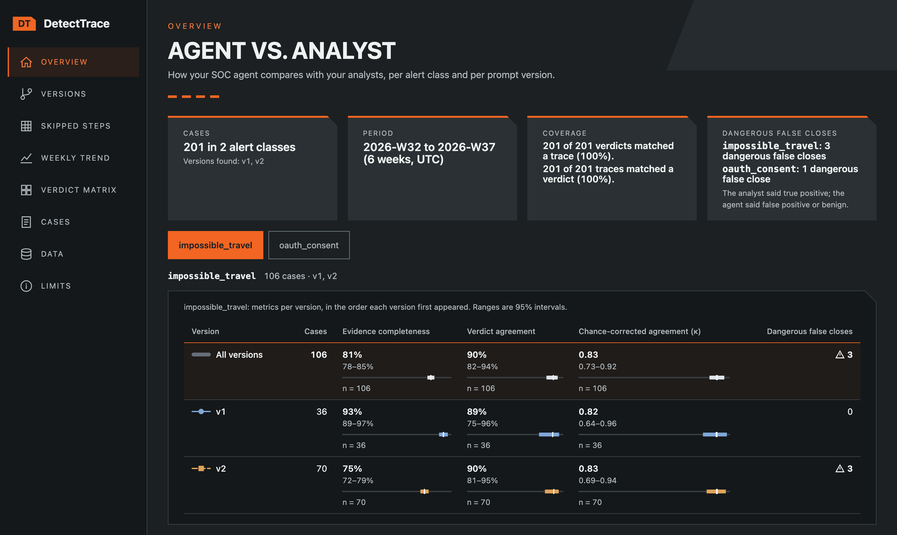
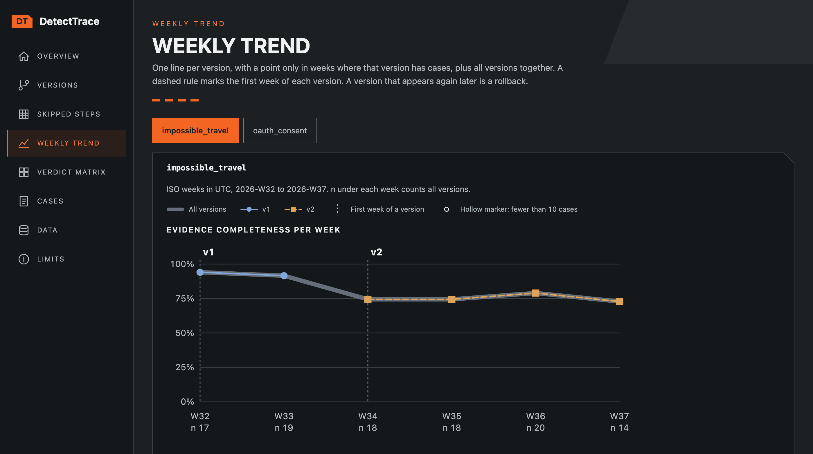
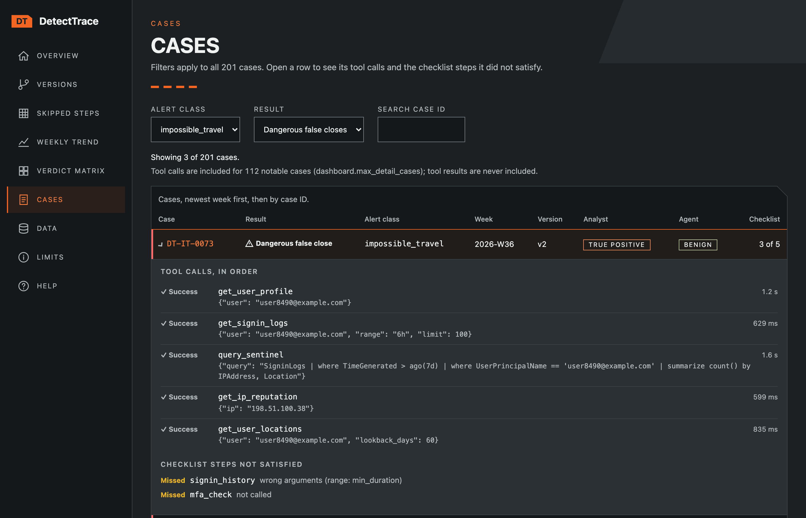

# The dashboard

This page lists the dashboard's pages, its term buttons, its page addresses and its footer.

All screenshots show the synthetic demo data, from `detecttrace ui`.

<!-- How the screenshots in docs/images/ were made: `detecttrace ui` on the demo data (all three
trace files, verdicts.csv and both checklists uploaded, with "Closed - Benign" mapped to benign and
"Malicious" to true_positive), captured with Playwright in Chromium at a 1400×900 viewport and 2×
device scale, dark theme. Each page or state was captured in turn: the Upload and Configuration
steps before Confirm, then the Overview, Weekly trend (impossible_travel) and Cases (dangerous false
closes, one row open) after the results arrived. Each frame ends above the page footer, the Overview
above its link tiles and the Weekly trend above its first "Show table" button. Each PNG was then
quantized with Pillow to a 128-colour palette (no dithering) and saved with optimize=True. -->

## Contents

- [Pages](#pages)
- [Term buttons](#term-buttons)
- [Page addresses](#page-addresses)
- [The footer](#the-footer)

## Pages

The dashboard has nine pages, however you open it. They are listed in a sidebar:

- **Overview**: the cases, the period, the coverage and the dangerous false closes, then the results by version for one alert class.

  

- **Versions**: evidence completeness, verdict agreement and chance-corrected agreement for each version, with intervals.
- **Skipped steps**: how often each checklist step was not satisfied, per version.
- **Weekly trend**: completeness and agreement per week, one line per version. Each chart can also be read as a table, and its points can be stepped through with the arrow keys.

  

- **Verdict matrix**: agent verdicts against analyst verdicts.
- **Cases**: every scored case. Filter by alert class, by result (all, disagreements, or dangerous false closes) and by case ID. Open a notable case's row to see its tool calls and the checklist steps it missed.

  

- **Data**: the coverage lines and every input problem, with how to fix it. In `detecttrace ui`, this is also where you upload files and confirm the configuration.
- **Limits**: what the dashboard does not tell you.
- **Help**: how DetectTrace works, what each page shows, how each measure is computed and how to read its numbers.

## Term buttons

On the Overview, Versions and Weekly trend pages, each measure's name is a button: hover over it, focus it or tap it to see what the measure means, with a link to its section on the Help page.

## Page addresses

Each page has its own address. In the file that `check` and `demo` write, it comes after the `#`, such as `#/cases?class=class-1&result=dangerous`, so the links stay inside the file. In `detecttrace ui` and `detecttrace serve`, it is a path, such as `/cases?class=class-1&result=dangerous`. A bookmark or a reload keeps the page, the selected alert class and the case filters.

## The footer

The footer names the DetectTrace version that wrote the page and says which network requests it makes.
